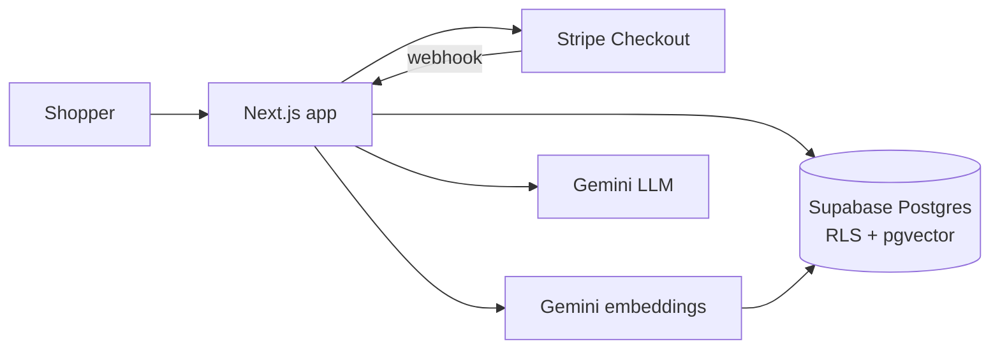

# Hyperloom: AI-Powered Futuristic E-commerce Store

Full-stack storefront with animated UI, Stripe test checkout, user accounts, an admin dashboard and **Loom**, an AI shopping assistant built on RAG.

**Live demo:** _add your Vercel link here_ · **Stack:** Next.js, Tailwind, Framer Motion, Supabase (Postgres, Auth, RLS, pgvector), Stripe, Gemini API


## Features
- **Storefront:** animated hero, category filters, search, sorting, product pages, glowing generated product visuals.
- **Cart and checkout:** persistent cart drawer, Stripe Checkout (test mode), PDF receipt download.
- **Orders:** created by a Stripe **webhook** (and the success page) through an atomic, idempotent Postgres function that also decrements stock.
- **Auth and roles:** Supabase Auth, order history per customer, protected admin dashboard (edit prices/stock, view revenue and orders).
- **Loom AI assistant (RAG):** product embeddings in pgvector, **hybrid retrieval** (SQL price filters + vector similarity), answers generated only from retrieved catalog rows, validated product cards in the chat.

## Architecture


## Security design
- Prices and stock always read from the database at checkout, never from the browser.
- Row-Level Security: customers can only read their own orders; roles cannot be self-assigned.
- Admin routes verify the login token and the `admin` role on the server.
- Webhook signature verification, secret keys server-side only, rate-limited AI endpoint.

## Run locally
```bash
cd web && npm install
# create web/.env.local (see below), run sql/01 to 06 in the Supabase SQL editor, then:
node --env-file=.env.local scripts/embed-products.mjs
npm run dev
```
Environment variables: `NEXT_PUBLIC_SUPABASE_URL`, `NEXT_PUBLIC_SUPABASE_PUBLISHABLE_KEY`, `SUPABASE_SECRET_KEY`, `STRIPE_SECRET_KEY`, `STRIPE_WEBHOOK_SECRET`, `GEMINI_API_KEY`, `GEMINI_MODEL`, `EMBED_MODEL`.

Test card: `4242 4242 4242 4242`. Demo store: no real payments, all products are fictional.